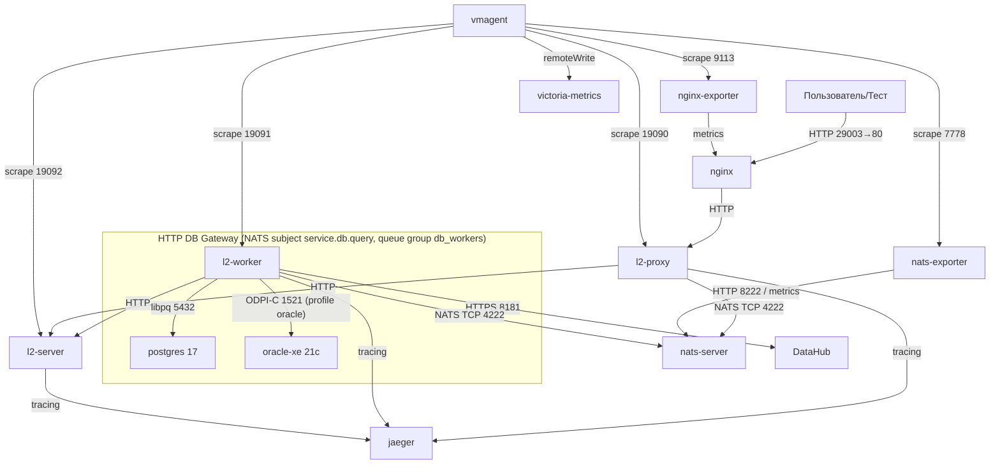
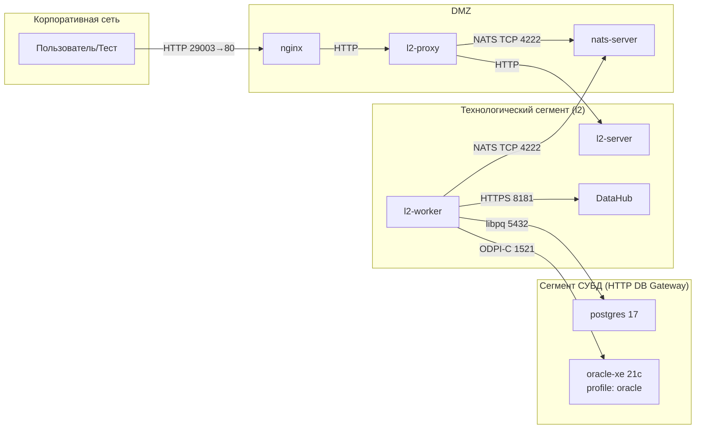

# Схема сетевых взаимодействий сервисов http-data-diod

## Визуальная схема взаимодействий

**Обозначения:**  
- Направление стрелки: всегда КЛИЕНТ 👉 СЕРВЕР (куда исходит инициатива запроса).
- Надписи на стрелках = используемый протокол, port (если важно).
- В скобках — порты проброшены наружу (наружу docker или наружу хоста).

---

## Сетевая схема с разделением сегментов (корпоративная сеть, DMZ, технологический сегмент l2)

**Обозначения к схеме:**
- Корпоративная сеть — рабочие пользователи, скрипты тестирования.
- DMZ — "демилитаризованная" зона для безопасного обмена между внешним и внутренним сегментом.
- Технологический сегмент l2 — критичные сервисы, worker, `l2-server`, внешние интеграции.
- Сегмент СУБД — PostgreSQL и опционально Oracle для `HTTP DB Gateway`.
- Все порты, протоколы и направления "клиент → сервер".
- Мониторинговые сервисы (`vmagent`, `victoria-metrics`, `jaeger`) на схеме отражены только в общей диаграмме.

---

## Таблица взаимодействий, портов и url

| Клиент/Источник      | Куда (Получатель)                  | Потокол | Внешний порт | Внутренний порт | URL/Endpoint                                | Описание/Назначение                  |
|----------------------|-------------------------------------|----------|--------------|-----------------|---------------------------------------------|---------------------------------------|
| Пользователь/тест    | nginx (nginx контейнер)             | HTTP     | 29003         | 80              | http://localhost:29003/                      | Точка входа, все входящие запросы     |
| nginx                | l2-proxy                    | HTTP     | -            | 8888            | /, /DataHub/DataHubSrv, /GantPool/GetGantDescr | proxy_pass, вся маршрутизация         |
| l2-proxy             | l2-server                           | HTTP     | -            | 8088            | ENV: `L2_SERVER_HOST`, `L2_SERVER_PORT`        | Основной upstream proxy для L2-логики |
| l2-proxy     | nats-server                         | TCP/NATS | -            | 4222            | ENV: NATS_HOST, NATS_PORT                   | Передача запросов в messaging-слой    |
| l2-worker    | nats-server                         | TCP/NATS | -            | 4222            | ENV: NATS_HOST, NATS_PORT                   | Получение запросов и ответ request/reply |
| l2-worker    | l2-server (или внешнему DataHub)    | HTTPS*   | -            | 8181 (внешний)  | L2_SERVER_URLS: https://odskc1.nlmk:8181/...| Запросы к DataHub/внешним ресурсам    |
| l2-worker            | postgres                            | TCP/libpq | 5432        | 5432            | ENV: `DB_POSTGRES_*`                          | Read-only SQL через HTTP DB Gateway   |
| l2-worker            | oracle                              | TCP/ODPI-C | 1521       | 1521            | ENV: `DB_ORACLE_*`                            | Read-only SQL через HTTP DB Gateway, profile `oracle` |
| vmagent              | сервисы l2 и экспортёры             | HTTP     | 19090/19091/19092/9113/7778 | 19090/19091/19092/9113/7778 | /metrics, scrape targets | Сбор метрик |
| vmagent              | victoria-metrics                    | HTTP     | 8428         | 8428            | /api/v1/write                                 | Remote write метрик                   |
| nginx-exporter       | nginx                               | HTTP     | 9113         | 9113            | http://nginx:9113/metrics                   | Экспозиция метрик nginx               |
| nats-exporter        | nats-server                         | HTTP     | 7778         | 7777            | http://nats-server:8222                     | Экспорт метрик NATS                   |
| jaeger               | принимает данные трейса             | HTTP     | 9411 (zipkin), 14268, 16686, 4317, 4318, 5778 | см. выше | см. выше | Трассировка запросов |

\* `l2-worker` инициирует HTTPS-запросы к внешнему DataHub (порт 8181).
- Поток `HTTP DB Gateway` идёт через `l2-proxy -> NATS subject service.db.query -> l2-worker -> PostgreSQL/Oracle`.
- PostgreSQL включён по умолчанию; Oracle поднимается только при включении profile `oracle` и `DB_ORACLE_ENABLED=true`.
- Стрелки всегда от клиента к серверу.
- В схеме обозначены только основные взаимодействия (core network flows).

---
